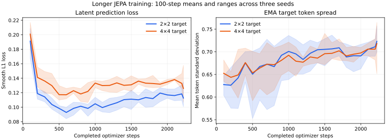

# Longer training across encoder seeds — October 14, 2026

The [prospective protocol](BUDGET-2026-10-14-PROTOCOL.md) was committed as
`49ab51e9edfa18c6277dd6360b7eaa30a2b6441e` before the six new training runs.
[Aggregate results and provenance](budget-2026-10-14-results.json) contain no
images, features, weights, classifier artifacts or per-image training records.

## Result

Each model trained from scratch for 2,223 steps, batch four. Both masks used
identical actual image order within each encoder seed: 8,892 draws and
8,072 / 8,061 / 8,112 unique training images for seeds 20261003 / 20261010 /
20261011. This is about ten times the previous 223-step budget, still below
one full traversal of the 45,000-image training partition.

| Representation | Tuning AdamW mean | Fresh AdamW mean | Fresh ridge mean |
|---|---:|---:|---:|
| Learned, 2x2 target | 27.00% | 24.24% | 25.47% |
| Learned, 4x4 target | 27.33% | 23.11% | 24.27% |
| Matching random encoders | 25.67% | 24.11% | 24.00% |
| Pixels | 28.00% | 25.73% | 30.20% |

AdamW means average classifier seeds within each encoder, then average three
encoder means. Pixel features are one shared baseline, not three independent
encoder runs. Fresh learned 2x2 / 4x4 encoder-mean sample SDs are 0.50 / 1.24
percentage points. Those describe three seeds on shared data, not confidence
intervals or independent sampling uncertainty.

The additional training did not establish a learned-feature advantage. The
2x2 AdamW mean is close to random; both masks trail pixels. A lower training
loss is not evidence of a better downstream representation. No mask winner
was selected from the fresh scores.

## What was verified

- All six training journals cover step one through 2,223, with finite diagnostics,
  the expected sampling RNG state and exact seeded training-partition draws.
  Periodic checkpoint recovery and chunking reproduce continuous synthetic runs.
- Every representation used the same 500 fitted / 200 tuning examples and
  classifier grids. All 72 saved selected states, original scores, reported
  selection rules and old paired errors reproduce. Losing candidates were
  not saved or refitted during auditing.
- All classifiers were locked before fresh extraction. The new balanced 500-row
  confirmation excluded all 746 previously observed tuning/confirmation rows.
  Every classifier retained its original normalization, weights and settings.
- A real cache-only retry disabled training, image reads, extraction and fitting,
  and reproduced all selected states/results. Synthetic corrupt-cache checks
  reject edited features while preserving the previous summary.
- 114 tests passed before adding the separate training-dynamics summary/plot.
  Official test images were not evaluated. No paid compute or APIs were used.

## Limits and next step

Equal steps and image order do not equalize predicted/visible tokens or compute
between masks. This is a small compact model, without augmentation or the
official I-JEPA multi-block recipe. The shared validation partition and this
new confirmation are now observed. Reserve different rows before a future
confirmation; retain the official test set for the final evaluation.

Next, predeclare a controlled model/input change, including position/input
choices or embedding width, and test it at the same budget rather than treating
loss reduction as quality evidence. The frozen pretrained transfer reference
remains stronger, with different supervision/architecture/resolution clearly
reported in its own experiment.

## Training dynamics

The plot uses [100-step window aggregates](budget-2026-10-14-dynamics.json),
including the final 23-step tail. Lines average the three encoder seeds and
ribbons show their range. The renderer verifies the complete local journals
against published source hashes; no raw images or per-image records appear.
Loss falls early and then partly rebounds, while target-token spread grows
overall. Downstream results still trail pixels. These changing EMA-teacher
diagnostics do not establish a cause or prove pooled-feature collapse.
