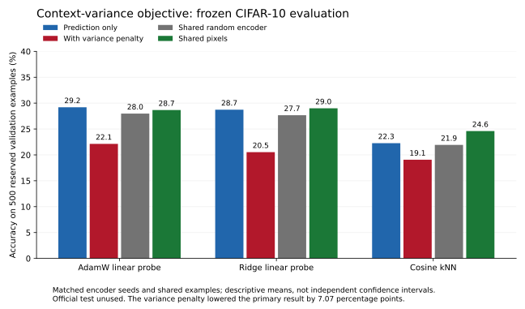

# Context-variance experiment — evaluated October 31, reported November 1, 2026

The predeclared variance penalty **reduced** the primary frozen-probe result: **22.13% versus 29.20%**, a **−7.07 percentage-point** context-variance-minus-prediction contrast on the same 500 fresh validation rows. Ridge and neighbors also favor prediction-only. This intervention did not establish better learned representations.

## Matched protocol and results

Used the [prospective complete protocol](CONTEXT-VARIANCE-2026-10-31-PROTOCOL.md), committed before real-image objective training or fresh scoring. All six 2,223-update runs start from scratch, share actual image-order journals and 29,472 trainable parameters. The original 500 fitting/200 tuning rows, model geometry, classifier budgets and 500-row reservation were retained. Training details and checkpoint hashes are in the [training-only audit](CONTEXT-VARIANCE-TRAINING-2026-10-31.md).

| Frozen representation | AdamW accuracy | Ridge accuracy | Cosine kNN accuracy |
|---|---:|---:|---:|
| Prediction only | 29.20% | 28.73% | 22.27% |
| Prediction + variance penalty | 22.13% | 20.53% | 19.07% |
| Shared exact-initialization random encoder | 27.98% | 27.67% | 21.93% |
| Shared pixels | 28.67% | 29.00% | 24.60% |

AdamW values average the three classifier initializations within each encoder seed, then the three encoder seeds. Ridge/kNN average encoder seeds; the shared pixel source has no encoder-seed replication. All use the same examples. These are descriptive validation means, not independent test estimates or confidence intervals.

| Encoder seed | Prediction-only AdamW | Variance-penalty AdamW | Difference |
|---|---:|---:|---:|
| 20261003 | 31.33% | 22.13% | -9.20 points |
| 20261010 | 30.60% | 21.07% | -9.53 points |
| 20261011 | 25.67% | 23.20% | -2.47 points |

The primary difference is negative at every encoder seed. Prediction-only is close to its random/pixel controls; its small average advantage does not establish a reliable learned-feature gain. Higher context spread and lower training prediction loss are insufficient evidence of useful representations. The experiment does not identify why the penalty failed or rule out different objectives/data/architectures. No penalty or classifier settings were retuned using these outcomes.

## Replay and evidence

- Saved and reproduced all **280 AdamW/ridge candidate states**, including losing states; selected **40 linear heads** and **10 neighbor indices**. Shared random/pixel controls are fitted once per unique source. Neighbor candidate scores replay on the fixed saved indices.
- Locked all states before fresh extraction and conservatively registered the original reservation. History now retains **3,246 observed rows**, leaving **1,754 unused**. Original source files remain unchanged; the official test remains reserved.
- Latest source bundle is `runs/context-variance-20261031/observed-exposure.json`, ledger SHA-256 `fbc1e416da738cb032a7cdc7a920128597813de4fc05ccb9c7793c84a0dcfcee`. Future reservations must retain this bundle and every original source file. Hashes cannot detect omitted experiments or authenticate an external producer.
- Real cache replay with training, both linear fitters, neighbor selection, feature extraction and raw-image indexing disabled reproduced the identical summary. All **358 artifact byte hashes** were unchanged.
- All **228 local tests**, seeded mask demo, synthetic training smoke and whitespace checks passed. Source code was unchanged after those checks. CI is verified separately at the pushed head.
- [Aggregate results, per-seed paired errors and provenance](context-variance-results-20261031.json). The [plot script](plot_objective_20261031.py) reads only this public aggregate file. Raw images, selections, journals, predictions, features and weights remain local/ignored. No paid compute or API.

## Next step

Keep this negative result. Inspect representations on fitting images before choosing another intervention; record a new prospective hypothesis and use the updated exposure ledger for any later fresh evaluation. Do not pick a new variance weight from these confirmation outcomes. No useful-feature, robustness or official-test improvement is claimed.
